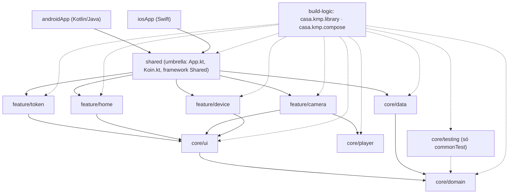

# Modularização, módulo a módulo

Registro do que a divisão em módulos Gradle (14/10/2026, commit `b7d05ea`) fez com cada parte do app: o que o módulo contém, de onde cada arquivo veio no projeto de um módulo só, qual é a sua API pública, de quem depende e quais testes ficaram nele. A visão geral (padrão adotado, regras, como entra uma feature nova) está na seção "Modularização" do [README](../README.md); as etapas e armadilhas, no [LOG §6](sdd/LOG.md).

## Como ficou



Regras que o grafo obedece: feature só depende de `core/*`; feature nunca depende de feature nem de `core/data` (fala com os dados pelas interfaces do domínio, injetadas pelo Koin); só `shared` conhece as features; `core/domain` não conhece ninguém. Nenhum arquivo de `androidApp` ou `iosApp` precisou mudar para o app continuar funcionando.

## Antes e depois

**Antes: um módulo só.** Tudo que não era casca nativa vivia no módulo Gradle `shared`, separado apenas por pacotes.

```text
MiboSmart Case/
├─ shared/                               ← o único módulo KMP
│  ├─ build.gradle.kts                   alvos Android + iOS, Compose, Ktor, libVLC, Koin,
│  │                                     GdiBuildConfig e o framework Shared, tudo aqui
│  └─ src/
│     ├─ commonMain/kotlin/br/com/pompeo/casa/
│     │  ├─ App.kt                       tema + NavHost + o HomeViewModel injetado
│     │  ├─ di/Koin.kt                   um módulo Koin com API, repositórios e ViewModel
│     │  ├─ domain/                      modelos, portas, casos de uso
│     │  ├─ data/                        Ktor, GDI, parser, erros, repositórios
│     │  ├─ ui/                          TokenScreen, HomeShell, CameraScreen, DeviceScreen,
│     │  │                               HomeViewModel (165 linhas, um para as 4 telas),
│     │  │                               Components, Theme, MiboLogic
│     │  ├─ player/                      CameraPlayer (expect)
│     │  └─ platform/                    isDebugBuild, WeekStrip (expect)
│     ├─ androidMain/                    Keystore, libVLC, actuals
│     ├─ iosMain/                        Keychain, ponte VLCKit, MainViewController, actuals
│     └─ commonTest/                     17 classes de teste + TestSupport.kt (fakes)
├─ androidApp/                           MainActivity, CasaApplication
└─ iosApp/                               ContentView, VLCVideoPlayer.swift
```

**Depois: módulos.** Cada responsabilidade com o seu `build.gradle.kts`, as suas dependências e os seus testes.

```text
MiboSmart Case/
├─ build-logic/convention/               plugins casa.kmp.library e casa.kmp.compose
├─ core/                                 sem tela
│  ├─ domain/                            domain/ (igual) + AppScope.kt               18 testes
│  ├─ data/                              data/, Keystore/Keychain, DataModule.kt,
│  │                                     GdiBuildConfig                              57 testes
│  ├─ ui/                                Components, Theme, MiboLogic, platform/      5 testes
│  ├─ player/                            CameraPlayer expect/actual (libVLC, VLCKit)
│  └─ testing/                           TestSupport.kt (os fakes, só para testes)
├─ feature/                              uma tela por módulo, cada uma com
│  │                                     ViewModel + rota + NavGraphBuilder.xScreen() + módulo Koin
│  ├─ token/                             TokenScreen,  TokenViewModel                 7 testes
│  ├─ home/                              HomeShell,    HomeViewModel                  7 testes
│  ├─ camera/                            CameraScreen, CameraViewModel                3 testes
│  └─ device/                            DeviceScreen, DeviceViewModel                9 testes
├─ shared/                               umbrella: App.kt (só o NavHost), Koin.kt (só a lista),
│                                        MainViewController, framework Shared
├─ androidApp/                           igual (+ core:domain para o teste em Java)
└─ iosApp/                               igual
```

Sentido das dependências: `androidApp`/`iosApp` → `shared` → `feature/*` → `core/ui` (e `core/player` na câmera) → `core/domain`; `core/data` → `core/domain`; `core/testing` só nos `commonTest`.

O que "modularizar" quer dizer aqui: em vez de um módulo Gradle `shared` com todos os pacotes dentro, cada responsabilidade vira um módulo Gradle próprio, com o seu `build.gradle.kts`, as suas dependências declaradas e os seus testes. O compilador passa a impedir o que antes era só combinado: uma tela não consegue importar outra tela nem o Ktor, porque o módulo dela não declara essas dependências. O que mudou de fato no código foi pouco: os arquivos de `domain`, `data`, `ui`, `player` e `platform` foram movidos sem alteração; o `HomeViewModel` único virou quatro ViewModels, um por tela; a navegação e o Koin de cada tela passaram a ficar na própria feature; e o que não pode morrer com a tela (comando da fechadura, `stopLive`) passou a rodar num escopo da aplicação.

## Resumo

Linhas contadas em `.kt`/`.kts` de `src/`, sem os `build.gradle.kts`. "Origem" diz de onde o conteúdo veio no projeto anterior (`shared/src/...`); "idêntico" significa que o `git` reconheceu o arquivo como movido sem nenhuma linha alterada.

| Módulo | Plugin | Código | Testes | Nº de testes | Depende de | Origem |
|---|---|---:|---:|---:|---|---|
| `build-logic` | (build incluído) | 99 | — | — | catálogo `libs` | novo |
| `:core:domain` | `casa.kmp.library` | 394 | 334 | 18 | nada | `domain/` idêntico + `AppScope.kt` novo |
| `:core:data` | `casa.kmp.library` | 995 | 1 398 | 57 | domain | `data/`, `di/PlatformModule.*` idênticos + `DataModule.kt` novo |
| `:core:ui` | `casa.kmp.compose` | 416 | 95 | 5 | domain | `ui/{Components,MiboLogic,Theme}`, `platform/` idênticos |
| `:core:player` | `casa.kmp.compose` | 250 | — | — | nada (libVLC no Android) | `player/` idêntico |
| `:core:testing` | `casa.kmp.library` | 199 | — | — | domain | `commonTest/TestSupport.kt` (menos um helper) |
| `:feature:token` | `casa.kmp.compose` | 287 | 153 | 7 | domain, ui | `ui/TokenScreen.kt` + ViewModel extraído |
| `:feature:home` | `casa.kmp.compose` | 910 | 133 | 7 | domain, ui | `ui/HomeShell.kt` + ViewModel extraído |
| `:feature:camera` | `casa.kmp.compose` | 542 | 104 | 3 | domain, ui, player | `ui/CameraScreen.kt` + ViewModel extraído |
| `:feature:device` | `casa.kmp.compose` | 1 031 | 178 | 9 | domain, ui | `ui/DeviceScreen.kt` + ViewModel extraído |
| `:shared` | `casa.kmp.compose` | 105 | — | — | todos | `App.kt`, `di/Koin.kt`, `MainViewController.kt` reescritos/mantidos |
| `:androidApp` | AGP application | — | — | 4 (Java) | shared, domain | 1 linha nova no `build.gradle.kts` |

Total: 106 testes Kotlin (JVM do host e simulador iOS) + 4 em Java, todos verdes depois da divisão. O `HomeViewModel` único (165 linhas) e o seu `HomeViewModelTest` (204 linhas) deixaram de existir: viraram quatro ViewModels e quatro classes de teste, uma por feature.

## `build-logic/` (plugins de convenção)

Build incluído por `pluginManagement { includeBuild("build-logic") }` no `settings.gradle.kts` da raiz. Lê o mesmo catálogo `gradle/libs.versions.toml` da raiz, para versões não se repetirem.

| Arquivo | Linhas | O que faz |
|---|---:|---|
| `settings.gradle.kts` | 38 | repositórios, o catálogo `libs` apontando para `../gradle/libs.versions.toml`, `include(":convention")` |
| `convention/build.gradle.kts` | 24 | `kotlin-dsl`; `compileOnly` dos marcadores dos plugins (KGP, AGP KMP, Compose, compilador Compose, serialização) e o jar dos acessores do catálogo, para o código Kotlin do plugin enxergar `libs` |
| `convention/src/main/kotlin/br/com/pompeo/casa/buildlogic/KmpLibrary.kt` | 45 | `fun Project.configureKmpLibrary()`: alvos `iosArm64`, `iosSimulatorArm64` e o alvo Android do AGP 9 (`KotlinMultiplatformAndroidLibraryTarget`) com `namespace` derivado do caminho do módulo (`:core:data` → `br.com.pompeo.casa.core.data`), `compileSdk`/`minSdk` do catálogo, JVM 11, `withHostTest {}` (testes na JVM do host); coroutines em `commonMain`, `kotlin.test` + `coroutines-test` em `commonTest` |
| `convention/src/main/kotlin/casa.kmp.library.gradle.kts` | 14 | aplica KGP + AGP KMP e chama `configureKmpLibrary()`. Para módulos sem tela |
| `convention/src/main/kotlin/casa.kmp.compose.gradle.kts` | 40 | o anterior + `org.jetbrains.compose`, compilador Compose e `kotlinx-serialization`; em `commonMain`: runtime/foundation/material3/ui do Compose, ícones, `lifecycle-runtime-compose`, `lifecycle-viewmodel-compose`, `navigation-compose`, `kotlinx-serialization-json`, `koin-core`, `koin-compose-viewmodel`. Para `core/ui`, `core/player`, as features e o umbrella |

Por que uma função Kotlin e não um plugin aplicando o outro: plugin pré-compilado que aplica outro plugin pré-compilado não gera os acessores `kotlin { }` para quem o consome. Por isso cada módulo Compose declara `alias(libs.plugins.kotlinMultiplatform)` ao lado de `id("casa.kmp.compose")`, só para o Gradle gerar os acessores do script. Armadilha registrada: um comentário com "feature/" seguido de asterisco dentro de `/* */` aninha o comentário em Kotlin e engole o script inteiro, silenciosamente.

## `core/domain`

Kotlin puro, sem Compose, Ktor ou Koin: o que o app sabe sobre dispositivos, token e erros, e as portas que os outros módulos implementam. Todo o conteúdo veio de `shared/src/commonMain/kotlin/br/com/pompeo/casa/domain/` sem nenhuma linha alterada; o pacote continua `br.com.pompeo.casa.domain`.

| Arquivo | Linhas | Conteúdo |
|---|---:|---|
| `model/Device.kt` | 82 | `Device`, `DeviceKind`, `DeviceOrigin`, `LockVolume`, `StreamSession`, eventos da fechadura |
| `model/DeviceQuery.kt` | 29 | `DeviceQuery`, `OriginFilter`, tamanho de página |
| `DevicesState.kt` | 30 | estado da lista (carregando, pronta, erro, `hasMore`) |
| `AppError.kt` | 24 | `AppError` (token ausente/inválido/expirado, rede, timeout, servidor) com `userMessage` |
| `ErrorMapper.kt` | 8 | porta `ErrorMapper` (`toAppError`, `toShortMessage`) |
| `ResultOf.kt` | 13 | `resultOf { }` que relança `CancellationException` |
| `TokenFormat.kt` | 32 | normalização, plausibilidade e máscara do token (`@JvmStatic`, chamado também do teste em Java) |
| `TokenStorage.kt` | 8 | porta do armazenamento seguro (Keystore/Keychain) |
| `provider/DeviceProvider.kt` | 35 | porta de um parceiro (GDI hoje): listar, online, fechadura, vídeo |
| `repository/DeviceRepository.kt` | 44 | porta do repositório de dispositivos (estado, paginação, filtro, `startLive`/`stopLive`, `logout`) e `LockController` |
| `repository/TokenRepository.kt` | 19 | porta do token (`token`, `suggested`, `persisted`, `masked()`) |
| `usecase/SubmitTokenUseCase.kt` | 44 | validar o token na API antes de gravar |
| `usecase/ChangeLockVolumeUseCase.kt` | 18 | gravar o volume, reler e assumir o pedido se a releitura falhar |
| `AppScope.kt` (novo) | 8 | `const val APP_SCOPE_NAME = "appScope"`: o qualificador Koin do `CoroutineScope` da aplicação, declarado aqui para as features pedirem o escopo sem conhecer `core/data` |

Dependências: só `kotlinx-coroutines-core` (pelo plugin). Testes (18, em `commonTest`, com os fakes de `:core:testing`): `TokenFormatTest` 3, `DomainModelTest` 4, `SubmitTokenUseCaseTest` 8, `ChangeLockVolumeUseCaseTest` 3.

## `core/data`

Tudo que fala com o mundo: Ktor contra a GDI, parser das respostas, mapeador de erro, implementações dos repositórios, armazenamento seguro por plataforma e o módulo Koin que registra isso. Os arquivos de `data/` e `di/PlatformModule.*` vieram idênticos de `shared`; `DataModule.kt` é a metade "dados" do antigo `di/Koin.kt`; a tarefa `generateGdiConfig` (gera `br.com.pompeo.casa.GdiBuildConfig` a partir do `local.properties` da raiz, agora em `core/data/build/generated/`) saiu do `shared/build.gradle.kts` para o deste módulo.

| Source set | Arquivo | Linhas | Conteúdo |
|---|---|---:|---|
| commonMain | `data/gdi/GdiApi.kt` | 231 | cliente Ktor: Bearer, `text/plain`, renovação única do token, endpoints de lista, online, fechadura, volume, histórico e vídeo |
| commonMain | `data/gdi/GdiDeviceParser.kt` | 85 | envelopes e nomes de campo alternativos, dedup, tipos |
| commonMain | `data/gdi/GdiDeviceProvider.kt` | 78 | `DeviceProvider` da GDI (o `ns` composto da fechadura via hub) |
| commonMain | `data/gdi/GdiErrorMapper.kt` | 51 | HTTP/rede/timeout → `AppError` |
| commonMain | `data/gdi/GdiFormat.kt` | 23 | data/hora e tipos de evento da fechadura |
| commonMain | `data/DeviceRepositoryImpl.kt` | 222 | paginação, filtro com fallback, geração, cancelamento, logout, vários parceiros (`getAll()`), `LockController`; recebe o `CoroutineScope` da aplicação |
| commonMain | `data/TokenRepositoryImpl.kt` | 49 | sessão em memória × persistida, `suggested` do `GdiBuildConfig` |
| commonMain | `di/DataModule.kt` (novo) | 43 | `expect val platformModule`; `dataModule`: `single(named(APP_SCOPE_NAME)) { CoroutineScope(SupervisorJob() + Dispatchers.Default) }`, `TokenRepository`, `GdiApi`, `DeviceProvider` qualificado `"gdi"`, `ErrorMapper`, `DeviceRepositoryImpl(tokens, providers = getAll(), scope = get(APP_SCOPE))` |
| androidMain | `data/security/KeystoreTokenStorage.kt` | 75 | Android Keystore |
| androidMain | `di/PlatformModule.android.kt` | 11 | `actual platformModule` com o `TokenStorage` do Keystore (usa o `Context` do `koin-android`) |
| iosMain | `data/security/KeychainTokenStorage.kt` | 117 | Keychain |
| iosMain | `di/PlatformModule.ios.kt` | 10 | `actual platformModule` com o Keychain |

Dependências: `api(:core:domain)`, `kotlinx-serialization-json`, `ktor-client-core`/`content-negotiation`/`serialization-kotlinx-json`, `koin-core`; `ktor-client-okhttp` + `koin-android` no Android; `ktor-client-darwin` no iOS. Testes (57, `commonTest`, com `:core:testing` e `ktor-client-mock`): `GdiApiTest` 19, `DeviceRepositoryImplTest` 17, `TokenRepositoryImplTest` 7, `GdiDeviceParserTest` 5, `GdiErrorMapperTest` 5, `GdiRealResponseTest` 2, `GdiFormatTest` 2.

## `core/ui`

Design system e utilidades de UI que mais de uma feature usa. Sem tela inteira. Veio idêntico de `shared` (`ui/Components.kt`, `ui/MiboLogic.kt`, `ui/Theme.kt` e `platform/`); os pacotes continuam `br.com.pompeo.casa.ui` e `br.com.pompeo.casa.platform`.

| Source set | Arquivo | Linhas | Conteúdo |
|---|---|---:|---|
| commonMain | `ui/Components.kt` | 259 | `FitText`, cartões, diálogos, badges, Snackbar e os demais componentes com as cores Mibo |
| commonMain | `ui/Theme.kt` | 25 | `MiboColors` e o tema |
| commonMain | `ui/MiboLogic.kt` | 31 | lentes, faixa da semana, rótulos |
| commonMain | `platform/BuildInfo.kt` | 4 | `expect val isDebugBuild` |
| commonMain | `platform/WeekStrip.kt` | 19 | `expect` do calendário (dia da semana de hoje) |
| androidMain / iosMain | `platform/BuildInfo.*.kt`, `platform/WeekStrip.*.kt` | 11 + 21 / 8 + 38 | `actual` com `BuildConfig`/`java.time` no Android e `NSCalendar`/`Platform.isDebugBinary` no iOS |

Dependências: `api(:core:domain)` (os componentes recebem `Device`, `AppError`), Compose pelo plugin, `koin-android` no Android. Testes (5): `MiboLogicTest`.

## `core/player`

O player de vídeo RTSP como `expect`/`actual`, isolado para a feature da câmera não carregar libVLC nem saber de Swift. Veio idêntico de `shared/.../player/`.

| Source set | Arquivo | Linhas | Conteúdo |
|---|---|---:|---|
| commonMain | `player/CameraPlayer.kt` | 25 | `expect fun CameraPlayer(url, muted, onFirstFrame, …)` |
| androidMain | `player/CameraPlayer.android.kt` | 135 | libVLC 3.7.7 (`org.videolan.android:libvlc-all`) numa `AndroidView` |
| iosMain | `player/NativeVideoPlayer.kt` | 33 | interface `NativeVideoPlayer` que o Swift implementa com VLCKit (SPM) e registra no arranque |
| iosMain | `player/CameraPlayer.ios.kt` | 57 | `UIKitView` que pede ao `NativeVideoPlayer` registrado a view do VLCKit |

Dependências: nenhuma de projeto; `libvlc` no Android. É o único módulo exportado ao Swift pelo framework (`export(projects.core.player)` no umbrella), porque o `iosApp` precisa de `NativeVideoPlayer`. Sem testes (só `expect`/`actual` sobre bibliotecas nativas).

## `core/testing`

Os dublês das portas do domínio, publicados como módulo (padrão Now in Android) para todos os `commonTest` usarem os mesmos fakes. Veio de `shared/src/commonTest/.../TestSupport.kt` para o `commonMain` deste módulo, menos o helper `homeViewModel()`, que montava o ViewModel único e não faz mais sentido.

`TestSupport.kt` (199 linhas): `InMemoryTokenStorage`, `ThrowingTokenStorage`, `device(...)`, `FakeProvider`, `FakeLockController`, `FakeTokenRepository(initial, canPersist)`, `FakeDeviceRepository`, `FakeErrorMapper`. Todo token é obviamente falso. Dependências: `api(:core:domain)`, `kotlin.test`, `coroutines-test`. Os outros módulos o declaram só em `commonTest` (`implementation(projects.core.testing)`), então ele não entra no APK nem no framework.

## `feature/token` (RF01)

Pacote `br.com.pompeo.casa.feature.token`. `TokenScreen.kt` veio de `shared/.../ui/TokenScreen.kt` com 6 linhas alteradas (pacote e o ViewModel que recebe); o resto é novo, extraído do `HomeViewModel` único.

| Arquivo | Linhas | Conteúdo |
|---|---:|---|
| `TokenScreen.kt` | 202 | a tela: escudo, campo mascarado, "Validando token…", pré-preenchimento pelo `local.properties` |
| `TokenViewModel.kt` | 55 | `TokenViewModel(tokens: TokenRepository, submitTokenUseCase, errors)`: `suggestedToken`, `tokenValidation: StateFlow<TokenValidation>` (`Idle`/`Validating`/`Done`/`Failed`), `submitToken(raw)` em `viewModelScope` (2.º toque ignorado), `tokenValidationHandled()` |
| `TokenNavigation.kt` | 30 | `@Serializable object TokenRoute`; `fun NavGraphBuilder.tokenScreen(onConnected: () -> Unit)` com `koinViewModel<TokenViewModel>()`; `val tokenFeatureModule = module { factoryOf(::SubmitTokenUseCase); viewModelOf(::TokenViewModel) }` |

O que saiu do antigo `HomeViewModel`: `TokenValidation`, `submitToken`, `tokenValidationHandled`, `suggestedToken`. Dependências: `api(:core:domain)`, `implementation(:core:ui)`. Testes (7, `TokenViewModelTest`): validação em `viewModelScope`, Done/Failed, segundo toque ignorado, cancelamento ao limpar o ViewModel.

## `feature/home` (RF02, RF07, RF08)

Pacote `br.com.pompeo.casa.feature.home`. `HomeShell.kt` veio de `shared/.../ui/HomeShell.kt` com 16 linhas alteradas (pacote, ViewModel e os três callbacks de navegação no lugar do `NavController`).

| Arquivo | Linhas | Conteúdo |
|---|---:|---|
| `HomeShell.kt` | 818 | Início (lista, chips de origem, "Carregar mais", cartões de erro) e Definições (itens por página, Atualizar, Sair) |
| `HomeViewModel.kt` | 62 | `HomeViewModel(repository: DeviceRepository, tokens: TokenRepository, errors)`: `state`, `query`, `devices`, `token`, `providerNames`, `providerName(device)`, `maskedToken()`, `refresh()`, `loadMore()`, `setOrigin()`, `setPageSize()`, `logout()`, `messageOf()`/`shortMessageOf()`, e `notice`, emitido no `init` quando há token e `!tokens.persisted` ("token válido, mas não gravado") |
| `HomeNavigation.kt` | 30 | `@Serializable object HomeRoute`; `fun NavGraphBuilder.homeScreen(onCamera: (Device) -> Unit, onDevice: (Device) -> Unit, onLogout: () -> Unit)`, que chama `vm.logout()` antes do callback; `val homeFeatureModule = module { viewModelOf(::HomeViewModel) }` |

Mudança de dono: o aviso de token não persistido era emitido pelo fluxo do token; como token e Home viraram features diferentes, a Home passou a derivá-lo de `tokens.persisted`. Dependências: `api(:core:domain)`, `implementation(:core:ui)`. Testes (7, `HomeViewModelTest`, repartidos do antigo `HomeViewModelTest`): aviso no `init`, logout, delegação ao repositório, mapeamento de erro.

## `feature/camera` (RF03)

Pacote `br.com.pompeo.casa.feature.camera`. `CameraScreen.kt` veio de `shared/.../ui/CameraScreen.kt` com 14 linhas alteradas; `CameraFormatTest` veio do `commonTest` do `shared` (3 linhas: pacote).

| Arquivo | Linhas | Conteúdo |
|---|---:|---|
| `CameraScreen.kt` | 464 | % e etapa, "AO VIVO", "1º quadro em X s", lentes, tela cheia, mudo, PTZ/gravar/microfone/foto com Snackbar "Indisponível na API GDI" |
| `CameraViewModel.kt` | 45 | `CameraViewModel(repository, errors, appScope: CoroutineScope)`: `devices`, `startLive(device, lens)` (relança cancelamento), `stopLive(session)` lançado no `appScope`, para o `stopLive` chegar à API mesmo com o ViewModel da tela já limpo |
| `CameraNavigation.kt` | 33 | `@Serializable data class CameraRoute(val ns: String)`; `fun NavGraphBuilder.cameraScreen(onBack: (NavBackStackEntry) -> Unit)`; `val cameraFeatureModule = module { viewModel { CameraViewModel(get(), get(), get(named(APP_SCOPE_NAME))) } }` |

Dependências: `api(:core:domain)`, `implementation(:core:ui)`, `implementation(:core:player)`. Testes (3): `CameraViewModelTest` 2 (`startLive` relança cancelamento; `stopLiveRunsInAppScopeAndSurvivesTheViewModel`), `CameraFormatTest` 1.

## `feature/device` (RF05, RF06, RF09)

Pacote `br.com.pompeo.casa.feature.device`. `DeviceScreen.kt` veio de `shared/.../ui/DeviceScreen.kt` com 35 linhas alteradas (pacote, ViewModel, callbacks). É a feature com mais lógica própria, porque herdou os comandos físicos do ViewModel único.

| Arquivo | Linhas | Conteúdo |
|---|---:|---|
| `DeviceScreen.kt` | 864 | fechadura (círculo de 600 ms, diálogo, bateria, Online, volume, histórico), hub (faixa da semana, firmware) e os demais tipos |
| `DeviceViewModel.kt` | 122 | `LockAction` (`Door`, `Volume`), `LockCommand` (`Sending`, `Done(error, appliedVolume)`); `DeviceViewModel(repository, changeLockVolumeUseCase, errors, appScope, commandState: MutableStateFlow<LockCommand?>)`: `devices`, `lockCommand`, `sendDoorCommand(lock, open)`, `changeLockVolume(lock, volume)`, `lockCommandHandled()`, histórico com `HISTORY_FIRST = 10` e `HISTORY_MORE = 30`. Os comandos rodam no `appScope` e a trava "um comando por vez" é o `commandState` compartilhado |
| `DeviceNavigation.kt` | 45 | `@Serializable data class DeviceRoute(val ns: String)`; `fun NavGraphBuilder.deviceScreen(onBack: (NavBackStackEntry) -> Unit)`; `val deviceFeatureModule = module { factoryOf(::ChangeLockVolumeUseCase); single(named("lockCommandState")) { MutableStateFlow<LockCommand?>(null) }; viewModel { DeviceViewModel(get(), get(), get(), get(named(APP_SCOPE_NAME)), get(named("lockCommandState"))) } }` |

Por que o estado do comando é um `single` do Koin e não um campo do ViewModel: o ViewModel agora é por tela (nasce ao abrir o detalhe, morre ao voltar). Se a trava vivesse nele, abrir e fechar a tela durante um comando permitiria um segundo comando. Dependências: `api(:core:domain)`, `implementation(:core:ui)`. Testes (9, `DeviceViewModelTest`): comandos da fechadura e do volume no escopo do app (um por vez, erro, volume aplicado), `theInFlightGuardIsSharedBetweenViewModelInstances`, histórico 10/30.

## `shared` (umbrella)

O único módulo que conhece todos os outros. Monta o grafo de navegação e o Koin, e gera o framework `Shared` que o Xcode consome. Os três arquivos já existiam; `App.kt` e `Koin.kt` encolheram.

| Arquivo | Linhas | Conteúdo |
|---|---:|---|
| `App.kt` | 68 | `MaterialTheme` com `MiboColors`; `koinInject<TokenRepository>()` para decidir o destino inicial (`HomeRoute` se há token, senão `TokenRoute`); `NavHost` que só chama `tokenScreen(onConnected = …)`, `homeScreen(onCamera = CameraRoute(ns), onDevice = DeviceRoute(ns), onLogout = …)`, `cameraScreen(onBack = popIfTop)`, `deviceScreen(onBack = popIfTop)`; `popIfTop` desempilha só se a entrada ainda é o topo |
| `di/Koin.kt` | 31 | `val appModules = listOf(dataModule, platformModule, tokenFeatureModule, homeFeatureModule, cameraFeatureModule, deviceFeatureModule)`; `initKoin(config)` para a `Application` do Android e `initKoin()` sem parâmetro para o Swift (`KoinKt.doInitKoin()`) |
| `MainViewController.kt` (iosMain) | 6 | `ComposeUIViewController { App() }`, inalterado |

`build.gradle.kts` (43 linhas): `casa.kmp.compose`; framework estático `Shared` para `iosArm64` e `iosSimulatorArm64` com `export(projects.core.player)`; `api(:core:domain)`, `api(:core:player)`, `implementation` de `:core:data`, `:core:ui` e das quatro features; `koin-android` no Android; `compose-ui-tooling` só no classpath de runtime do Android (previews). O que saiu daqui: os alvos e dependências que o plugin de convenção passou a dar, a tarefa `generateGdiConfig` (para `core/data`) e as dependências de Ktor/libVLC (para `core/data` e `core/player`).

## `androidApp` e `iosApp`

- `androidApp/build.gradle.kts`: uma linha nova, `implementation(projects.core.domain)`, porque o teste em Java (`TokenFormatJavaTest`) chama `TokenFormat` do domínio. `MainActivity` e `CasaApplication.java` continuam chamando `App()` e `KoinKt.initKoin(...)` como antes.
- `iosApp`: nenhum arquivo mudou. O Swift continua a importar `Shared`, implementar `NativeVideoPlayer` com VLCKit e chamar `KoinKt.doInitKoin()`; a tarefa `embedAndSignAppleFrameworkForXcode` do umbrella é a mesma.

## Verificação

- Testes: `./gradlew testAndroidHostTest` (106 verdes na JVM do host) e `./gradlew iosSimulatorArm64Test` (os mesmos 106 no simulador iOS); `./gradlew :androidApp:testDebugUnitTest` (4 em Java).
- Regras de dependência, conferidas por `grep` vazio: nenhum `import br.com.pompeo.casa.feature.` dentro de `feature/*` apontando para outra feature; nenhum `import br.com.pompeo.casa.data.` em `feature/*`; nenhum `import br.com.pompeo.casa.feature.` em `core/*`; nenhum `projects.feature` fora de `shared/build.gradle.kts`.
- Aparelhos (14/10/2026, token novo no `local.properties`): no Moto G9 Play, token → Home com os 3 dispositivos → MFR 2030 ("Porta fechada", bateria, Online, histórico) → MCA 1002 (Online, "Firmware 2.4.628243") → iM4 Dual ("AO VIVO", "1º quadro em 81,1 s" a frio), sem nenhum crash no logcat; no iPhone 13 Pro, Home e iM4 Dual "AO VIVO" ("1º quadro em 42,7 s") depois de trocar o token na tela. Nenhum comando de fechadura ou de volume foi enviado. Linha 20 da tabela "Verificação em aparelho" do README.
